<div align="center">


# 拾页 Folio

**把网页与在线文档，存成随时能打开的本地资料。**

PDF · Word · Markdown · 单文件 HTML

[下载预览版](https://github.com/xyra17/folio-archive/releases) · [导出效果](#导出效果) · [开始使用](#开始使用) · [开发指南](docs/guide/development.md) · [反馈问题](https://github.com/xyra17/folio-archive/issues)


[](LICENSE)


</div>

粘贴链接、选择格式、保存到电脑。拾页会提取正文和图片，保留标题、列表、代码与表格等结构，生成适合阅读、打印或继续编辑的文件。

基础保存与导出无需注册拾页账号，也不需要配置 AI 服务。

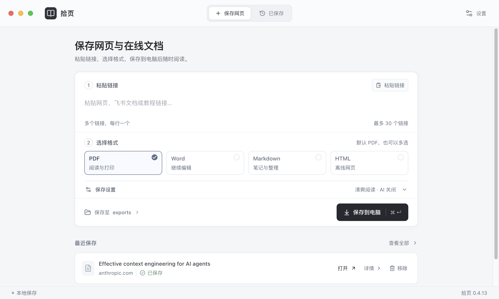

*示例来源：[Anthropic 的上下文工程文章](https://www.anthropic.com/research/effective-context-engineering-for-ai-agents)。截图用于展示保存流程；文章版权归原作者所有，仓库不附带其全文归档。*

## 能做什么

- **一次保存，多种用途。** 同时导出 PDF、Word、Markdown 和 HTML，并打包为 ZIP。
- **整理长文与多章资料。** 按已发现目录选择章节，设置起始标题或排除小节；支持批量链接、暂停与继续。
- **离线阅读。** HTML 内嵌成功保存的图片，带目录、阅读进度、深色模式和代码复制，单个文件即可打开。
- **找到已经存过的内容。** 使用集合、标签和本地正文搜索整理资料；文件按日期与文章标题命名。
- **保留处理结果。** 缺图、访问限制和提取问题会记入归档报告；可以重试失败素材或用已保存内容重新导出。

PDF / Word 提供四种排版模板：清爽阅读、书刊印刷、技术手册、杂志精选。AI 辅助检查可选，默认关闭。

## 导出效果

以下四种格式均来自 **0.4.13 对同一篇文章的实际导出**：[Anthropic · Effective context engineering for AI agents](https://www.anthropic.com/research/effective-context-engineering-for-ai-agents)。可以对照查看同一份正文、标题与原文插图在不同格式中的效果。

### PDF：分页阅读与打印

实际 PDF 共 10 页，纸张为 A4，使用「清爽阅读」模板。下图是首页，保留文章标题、来源域名、正文层级和页码。

<p align="center">
  <a href="docs/assets/anthropic-pdf-page-1.png">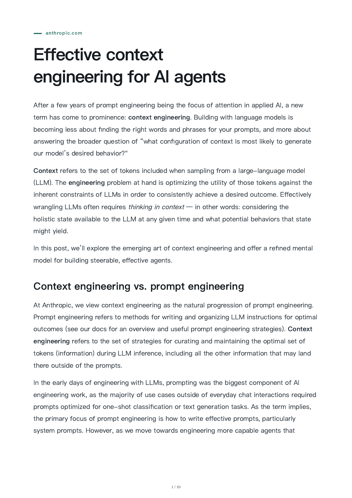</a>
</p>

<details>
<summary>查看第 2 页：原文插图与后续正文</summary>

<p align="center">
  <a href="docs/assets/anthropic-pdf-page-2.png">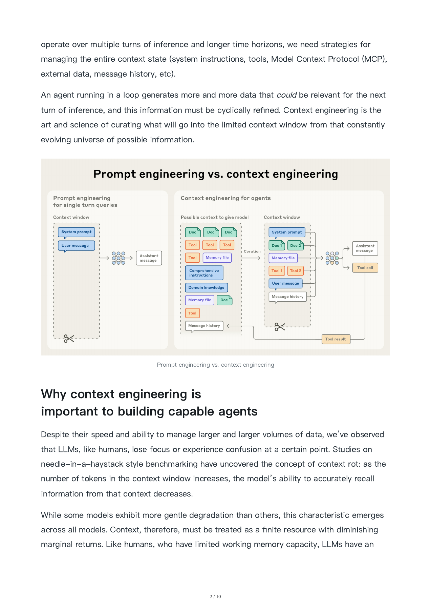</a>
</p>

</details>

### Word：保留内容，继续编辑

同一篇文章的 `.docx` 在 **Microsoft Word for Mac** 中打开，可继续编辑标题、正文与图片。左侧可见分页缩略图；图中的蓝色换行符是编辑器显示的格式标记。

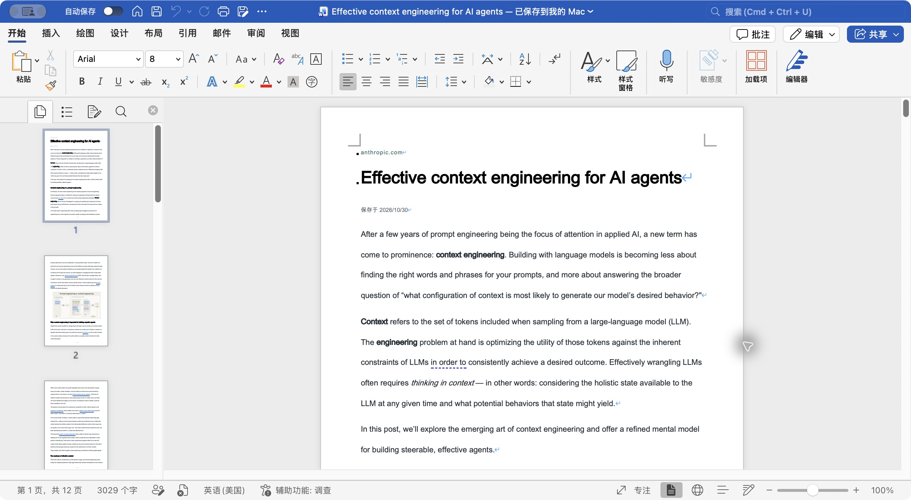

### Markdown：放进自己的笔记库

同一篇文章的 `.md` 在 **Typora** 中打开，保留来源链接、获取时间、标题、正文与插图。样式由阅读器决定，图片保存在同目录的 `assets/` 中，移动资料时需一起保留。

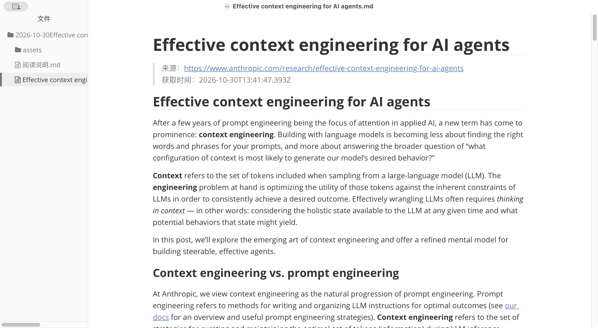

<details>
<summary>查看 Markdown 中的原文插图</summary>

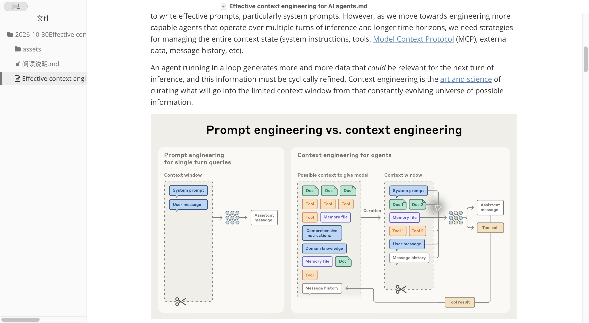

</details>

### HTML：一个文件，浏览器离线阅读

同一篇文章导出的单文件 HTML，直接在 **Safari** 中以本地 `file://` 地址打开。左侧目录可跳转，顶部支持深色阅读和打印；成功保存的图片内嵌在文件中。

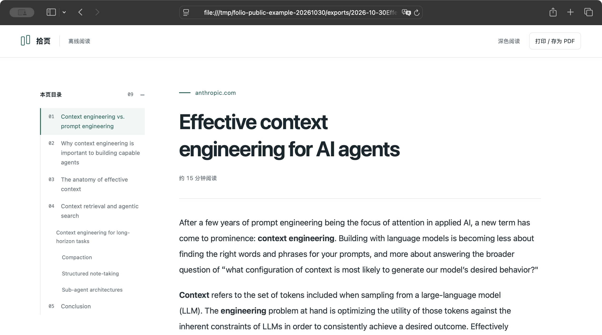

<details>
<summary>查看深色阅读、原文插图与阅读进度</summary>

**深色阅读**

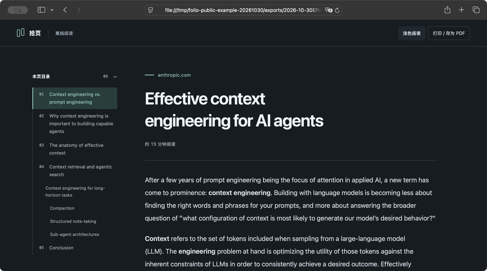

**原文插图与阅读进度**

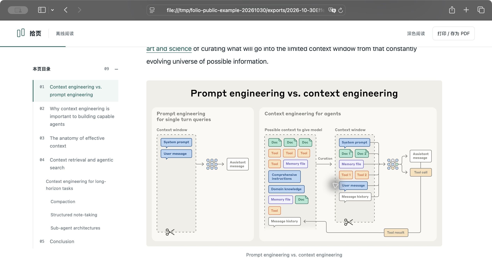

</details>

截图可点击放大。文章与插图版权归 Anthropic 及原作者所有；以上仅展示部分页面的导出效果，第三方内容不属于本项目的 MIT 授权范围。

## 下载与安装

前往 [Releases](https://github.com/xyra17/folio-archive/releases) 下载预览版。

| 平台 | 当前状态 |
| --- | --- |
| macOS · Apple Silicon（M 系列） | 已打包并在本机验证，提供 DMG / ZIP |
| macOS · Intel | 尚未构建与验证 |
| Windows | 已有构建配置，尚未构建与验证 |
| Linux | 暂无安装包 |

打开 DMG，将「拾页」拖入「应用程序」后启动。最终用户无需安装 Node.js、Python 或其他转换工具。

> 当前为早期预览版，macOS 安装包尚未完成 Developer ID 签名与公证。首次打开可能出现系统安全提示；如需自行构建，请看[开发指南](docs/guide/development.md)。

## 开始使用

1. 粘贴网页或在线文档链接。多个链接每行一个，单次最多 30 个。
2. 选择 PDF、Word、Markdown、HTML，可多选。需要调整排版或章节范围时，展开「保存设置」。
3. 点击「保存到电脑」。遇到登录提示时，在应用提供的来源窗口完成登录，再继续保存。
4. 保存完成后点击「打开」，或从「已保存」查找历史资料。

可以用上方 Anthropic 文章链接体验，也可以点击空资料库中的「试一份示例」，使用应用自带的本机演示内容。

### 操作预览

**1. 粘贴链接，同时选择需要的格式**

以 Anthropic 文章为例，四种格式可一次勾选，保存后统一放入文章文件夹。

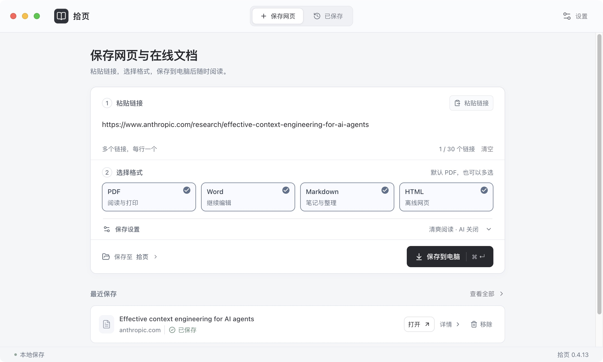

**2. 保存完成，直接打开文件**

完成界面见本文开头的[保存结果截图](docs/assets/save-article.png)。点击「打开」查看导出结果，也可到「已保存」查找历史记录。

**3. 四种格式与素材保存在同一文件夹**

这篇文章的实际导出目录中，PDF、Word、Markdown、HTML 与 ZIP 资料包使用相同标题；本地图片放在 `assets/`，另附阅读说明和归档报告。

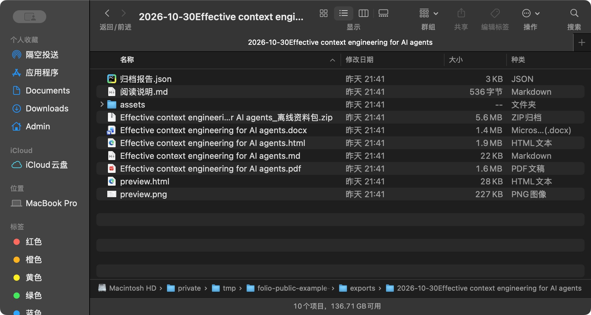

### 选哪种格式？

| 格式 | 适合用来 | 文件如何保存 |
| --- | --- | --- |
| PDF | 阅读、打印、保持纸张版式 | 普通正文可搜索；来源 PDF 优先保留原件 |
| Word `.docx` | 继续编辑、整理材料 | 正文、常规表格与图片写入文档 |
| Markdown `.md` | 做笔记、接入个人知识库 | 与同目录下的 `assets/` 图片一起保留 |
| HTML | 浏览器离线阅读 | 图片内嵌，单个文件可移动和打开 |
| ZIP | 备份、迁移资料 | 包含导出文件、本地素材与归档报告 |

默认保存位置为用户文稿目录中的「拾页归档」，可在设置中修改。文件夹命名为 `2026-10-30文章标题`，同一天重名会追加 `(2)`、`(3)`。

更多操作见[使用指南](docs/guide/usage.md)。

## 保存范围与已知限制

拾页适合保存文章正文和可访问的在线文档。网页结构、懒加载与来源权限会影响结果，保存后建议检查关键内容。

| 内容 | 当前处理方式 |
| --- | --- |
| 普通文章 | 保存当前页正文，不把导航和推荐链接当作章节 |
| 多章在线资料 | 按发现的章节目录采集；未知来源总量时不保证全部内容已发现 |
| 登录与权限 | 需要自己的访问权限；可见的登录、付费或禁止导出提示会阻止或暂停相关流程 |
| 画板、多维表格、嵌入组件 | 部分可见组件尝试以截图保留，并标记替代方式；不代表全部数据或交互状态 |
| 原始 PDF | 保存 PDF 原件，不反向转换为 Word、Markdown 或 HTML；暂不提供 OCR |
| 公式与复杂表格 | PDF / HTML 支持数学排版；Word 保留公式源。合并单元格与复杂跨页内容需核对 |

当前不包含浏览器扩展、云同步、EPUB 或定时归档。自动更新需要配置发布渠道，预览版可从 Releases 手动下载更新。

## 数据与隐私

- 任务记录、登录会话和归档文件保存在本机，应用没有拾页云端资料库。
- 采集时会访问你提供的来源网页及其资源；保存后的本地文件可离线使用。
- 基础采集、排版和规则检查不需要模型服务。
- **只有你配置并启用 AI 辅助检查时**，相关正文证据和所选页面截图才会发往你配置的模型端点。连接测试也会主动请求该端点。
- 模型密钥使用 Electron `safeStorage` 加密保存；来源登录会话由独立浏览器会话保存。
- 诊断包由你主动导出，不会自动上传。

具体的数据位置、网络请求和清理方式见[数据与隐私说明](docs/guide/privacy.md)。请只归档你有权访问和保存的内容。

## 本地开发

需要 **Node.js 24+** 和 npm，当前主要开发与验证环境为 macOS Apple Silicon。

```bash
git clone https://github.com/xyra17/folio-archive.git
cd folio-archive
npm ci
npm run dev
```

```bash
npm test             # 单元测试
npm run build        # 类型检查、前端与 Electron 构建
npm run test:e2e     # 启动 Electron，验证实际采集与导出流程
npm run package:mac  # 生成 macOS arm64 .app
npm run dist:mac     # 生成 macOS arm64 DMG / ZIP
```

开发模式默认使用应用的本地资料目录。需要隔离测试数据时，在运行命令前设置 `FOLIO_DATA_DIR`；完整命令与目录说明见[开发指南](docs/guide/development.md)。

技术栈：Electron、React、TypeScript、SQLite（sql.js）；正文提取使用 Mozilla Readability，PDF 由 Chromium 生成，Word 由 docx 生成。

## 反馈与贡献

欢迎通过 [Issues](https://github.com/xyra17/folio-archive/issues) 反馈问题、提供可复现的公开页面，或提交改进文档与代码的 Pull Request。

请附上应用版本、系统与芯片、操作步骤、预期和实际结果。涉及私密文档时，请用不含敏感内容的示例复现，不要上传登录 Cookie、密钥或整份个人资料库。

提交代码前请阅读[贡献指南](CONTRIBUTING.md)。安全问题的报告方式见[安全说明](SECURITY.md)。

## 许可证与致谢

项目采用 [MIT License](LICENSE)。第三方依赖保留各自的许可证，详见 [THIRD_PARTY_NOTICES.md](THIRD_PARTY_NOTICES.md)。示例文章与第三方网站内容的版权归原作者所有，不属于本项目的 MIT 授权范围。

感谢 [Mozilla Readability](https://github.com/mozilla/readability)、[Electron](https://github.com/electron/electron)、[docx](https://github.com/dolanmiu/docx)、[PDF.js](https://github.com/mozilla/pdf.js) 等项目。
